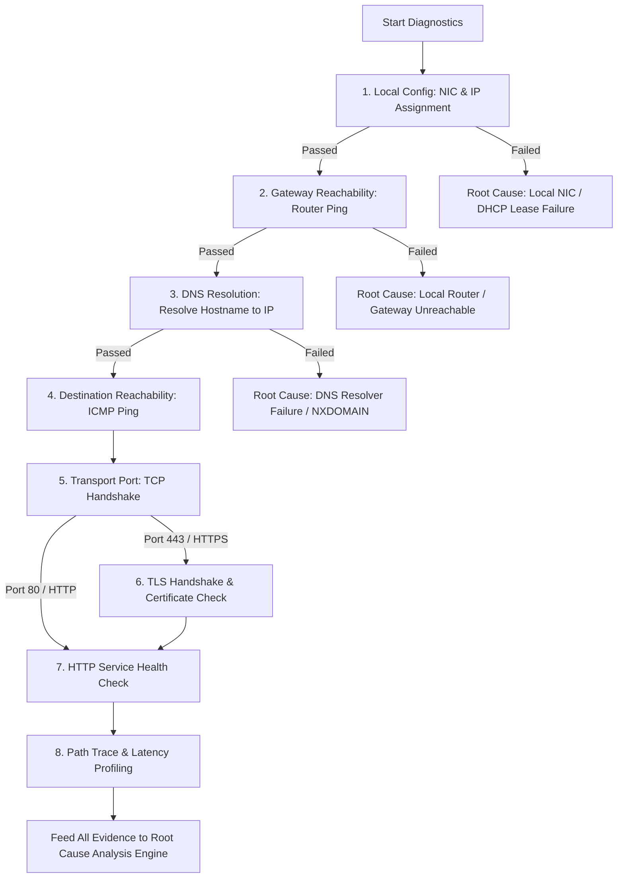

# Computer Networks Technical Guide & Viva Defense Manual
**Project: Network Troubleshooting Assistant (NTA)**  
**Target Audience: Student / Viva Candidate (to explain the project to Computer Networks Professor)**

---

## Table of Contents
1. [Executive Summary & Academic Value](#1-executive-summary--academic-value)
2. [Mapping the Project to OSI & TCP/IP Reference Models](#2-mapping-the-project-to-osi--tcpip-reference-models)
3. [The Ordered Diagnostic Pipeline (Layered Troubleshooting)](#3-the-ordered-diagnostic-pipeline-layered-troubleshooting)
4. [Deep-Dive: Function-by-Function Networking Mechanics](#4-deep-dive-function-by-function-networking-mechanics)
   - [Stage 1: Local Network Configuration (`local_config.py`)](#stage-1-local-network-configuration-local_configpy)
   - [Stage 2: Default Gateway Reachability (`gateway.py`)](#stage-2-default-gateway-reachability-gatewaypy)
   - [Stage 3: DNS Hostname Resolution (`dns.py`)](#stage-3-dns-hostname-resolution-dnspy)
   - [Stage 4: Remote Destination Reachability (`connectivity.py`)](#stage-4-remote-destination-reachability-connectivitypy)
   - [Stage 5: Transport Layer Port Availability (`connectivity.py`)](#stage-5-transport-layer-port-availability-connectivitypy)
   - [Stage 6: Application Layer & Security - TLS & HTTP (`http_tls.py`)](#stage-6-application-layer--security---tls--http-http_tlspy)
   - [Stage 7: Round-Trip Latency & Packet Loss Profiling (`latency.py`)](#stage-7-round-trip-latency--packet-loss-profiling-latencypy)
   - [Stage 8: Bounded Path Traceroute & Hop Analysis (`traceroute.py` & `traceroute_visualizer.py`)](#stage-8-bounded-path-traceroute--hop-analysis-traceroutepy--traceroute_visualizerpy)
5. [The Root Cause Analysis (RCA) Engine (`root_cause.py`)](#5-the-root-cause-analysis-rca-engine-root_causepy)
6. [Fault Simulation Lab: Synthetic Network Anomalies (`scenarios.py`)](#6-fault-simulation-lab-synthetic-network-anomalies-scenariospy)
7. [Enterprise Automation: Batch Auditing & Background Monitoring](#7-enterprise-automation-batch-auditing--background-monitoring)
8. [Natural Language Symptom Intake & Explainability (`llm/`)](#8-natural-language-symptom-intake--explainability-llm)
9. [Viva Defense: Top 25 Professor Questions & Golden Answers](#9-viva-defense-top-25-professor-questions--golden-answers)

---

## 1. Executive Summary & Academic Value

The **Network Troubleshooting Assistant (NTA)** is an automated diagnostic and root-cause analysis system engineered around standard **Computer Networking (CN) protocols and RFC specifications**. 

### Why this project is academically significant:
In traditional network administration, a technician manually runs disparate command-line utilities (`ipconfig`, `arp`, `ping`, `nslookup`, `tracert`, `telnet`, `curl`, `openssl`). These tools output fragmented information and do not correlate failures across layers. 

NTA implements a **systematic, deterministic, cross-layer diagnostic engine** that:
1. Executes bounded, non-destructive network probes from Layer 2 up to Layer 7.
2. Isolates whether a failure stems from the **Physical/Data-Link layer** (no IP / cable disconnected), **Local Routing** (gateway down), **Name Resolution** (DNS NXDOMAIN/timeout), **Transport/Firewall** (TCP SYN timeout or RST), **Cryptographic Presentation** (TLS certificate mismatch), or **Application Layer** (HTTP 5xx server crash).
3. Uses a **Heuristic Inference Engine** with confidence scoring to deliver plain-language root causes and actionable remediations.
4. Includes a **Fault Simulation Lab** capable of demonstrating real-world networking anomalies without disrupting the physical host's network adapter.

---

## 2. Mapping the Project to OSI & TCP/IP Reference Models

When explaining your project to your Professor, show how every module maps directly into the standard network protocol stacks:

```
+---------------------------------------------------------------------------------------------------+
| OSI Model Layer            | TCP/IP Model Layer    | Diagnostic Modules & Protocols Tested        |
+----------------------------+-----------------------+----------------------------------------------+
| 7. Application Layer       |                       | http_tls.py (HTTP GET/HEAD, status codes)    |
| 6. Presentation Layer      | Application Layer     | http_tls.py (SSL/TLS 1.2/1.3, X.509 certs)   |
| 5. Session Layer           |                       | dns.py (DNS UDP/TCP Port 53, A/AAAA records) |
+----------------------------+-----------------------+----------------------------------------------+
| 4. Transport Layer         | Transport Layer       | connectivity.py (TCP 3-Way Handshake, SYN/RST)
|                            |                       | latency.py (RTT sampling, jitter, packet drop)
+----------------------------+-----------------------+----------------------------------------------+
| 3. Network / Internet      | Internet Layer        | gateway.py (Default Gateway ICMP Echo)       |
|                            |                       | traceroute.py (IP TTL decrement, ICMP Type 11)|
|                            |                       | connectivity.py (Destination ICMP Type 8/0)  |
+----------------------------+-----------------------+----------------------------------------------+
| 2. Data Link Layer         | Network Interface /   | local_config.py (NIC state, MAC, ARP cache)  |
| 1. Physical Layer          | Link Layer            | local_config.py (Link UP/DOWN, cable/Wi-Fi)  |
+----------------------------+-----------------------+----------------------------------------------+
```

---

## 3. The Ordered Diagnostic Pipeline (Layered Troubleshooting)

### Why Order Matters in Computer Networks:
In network engineering, diagnosing top-down or jumping straight to an application test (like opening a browser) leads to false conclusions. If a website fails to load:
- Is the website down?
- Is the local Wi-Fi disconnected?
- Did DNS fail?
- Did the router crash?

NTA executes an **orchestrated bottom-up layered pipeline**:



---

## 4. Deep-Dive: Function-by-Function Networking Mechanics

---

### Stage 1: Local Network Configuration (`local_config.py`)

#### Function:
[`run_local_config_diagnostic()`](file:///c:/Users/Dipti/Mini%20projects/CN%20mini/diagnostics/local_config.py#L14)

#### What the code does:
Queries the host operating system routing tables and network adapter states via `psutil` and OS system commands to discover:
- Operational Network Interfaces (Ethernet, Wi-Fi, loopback).
- Assigned IPv4/IPv6 addresses and subnet masks.
- Default Gateway IP address.
- Active DNS resolver IP addresses.

#### Underlying Computer Networks Concepts:
1. **Network Interface Card (NIC) & Link State (Layer 1 & 2):**
   - The NIC must establish link synchronization with the local switch or wireless access point.
2. **IP Addressing & Subnet Mask (Layer 3 - RFC 791):**
   - A host requires a valid IP address within its local subnet. 
   - **APIPA Detection:** If the IP begins with `169.254.x.x`, the operating system failed to receive a DHCP response (RFC 3927 - Automatic Private IP Addressing).
3. **DHCP (Dynamic Host Configuration Protocol - RFC 2131):**
   - DHCP operates via the 4-step DORA process (`Discover`, `Offer`, `Request`, `Acknowledge`) over UDP ports 67 and 68. If DORA fails, no IP or default gateway is assigned.
4. **Default Gateway Routing Entry (RFC 1122):**
   - The OS routing table must have a `0.0.0.0/0` default route pointing to the local router. Without it, packets destined outside the subnet cannot be dispatched.

#### How to explain to the Professor:
> *"Professor, before testing remote servers, we must verify the local host's link and network stack. This function inspects whether the NIC is operational, whether DHCP successfully assigned an IP, and whether a default route `0.0.0.0/0` exists. If we detect an APIPA address `169.254.x.x` or no active IPv4 address, we immediately halt remote assumptions because the machine has not even completed Layer 2/3 local initialization."*

#### Professor Viva Q&A:
- **Q:** *Why does the function ignore `127.0.0.1` and `169.254.x.x` when evaluating active interfaces?*  
  **A:** `127.0.0.1` is the loopback interface used strictly for inter-process communication on the local host. `169.254.x.x` is an APIPA address assigned by the OS when DHCP fails; it cannot route to external networks or the internet.
- **Q:** *How does a computer know if a target IP is on the local LAN or needs the Default Gateway?*  
  **A:** The host performs a bitwise AND operation between the destination IP and its configured Subnet Mask. If the resulting network ID matches its own network ID, it uses ARP to communicate directly. If different, it sends the packet to the Default Gateway's MAC address.

---

### Stage 2: Default Gateway Reachability (`gateway.py`)

#### Function:
[`check_gateway_reachability(gateway_ip, ping_count=3, timeout_sec=2)`](file:///c:/Users/Dipti/Mini%20projects/CN%20mini/diagnostics/gateway.py#L11)

#### What the code does:
Dispatches bounded ICMP Echo Request packets directly to the discovered default gateway IP.

#### Underlying Computer Networks Concepts:
1. **Address Resolution Protocol (ARP - RFC 826):**
   - To send an IP packet to the default gateway, the host must first encapsulate the IP packet into an Ethernet frame.
   - It broadcasts an **ARP Request** (`Who has 192.168.1.1? Tell 192.168.1.50`). The gateway responds with an **ARP Reply** providing its 48-bit MAC address, which is cached in the host's ARP table.
2. **ICMP (Internet Control Message Protocol - RFC 792):**
   - **Type 8, Code 0:** ICMP Echo Request transmitted by the host.
   - **Type 0, Code 0:** ICMP Echo Reply transmitted back by the router.
3. **Local Loop Isolation:**
   - If the gateway ping succeeds, it proves that the local physical media (Ethernet cable / Wi-Fi RF carrier), Data Link framing, ARP resolution, and router IP stack are functioning.

#### How to explain to the Professor:
> *"Professor, the Default Gateway is our exit point to the WAN and Internet. By pinging the gateway directly, we isolate local LAN issues from upstream ISP issues. If the gateway does not respond, the problem is strictly inside the user's home or office network (e.g., router turned off, bad Ethernet cable, or Wi-Fi disconnection)."*

#### Professor Viva Q&A:
- **Q:** *What if the gateway does not respond to ping, but the user can still browse the web?*  
  **A:** Some enterprise security routers intentionally disable ICMP Echo Reply on the LAN interface to harden against discovery attacks while continuing to route TCP/UDP traffic. Our engine marks this as a WARNING rather than an outright fatal error.
- **Q:** *What layer does ARP operate at?*  
  **A:** ARP operates between Layer 2 (Data Link) and Layer 3 (Network). It translates Layer 3 IP addresses into Layer 2 MAC addresses.

---

### Stage 3: DNS Hostname Resolution (`dns.py`)

#### Function:
[`run_dns_resolution(target_host, timeout_sec=3.0)`](file:///c:/Users/Dipti/Mini%20projects/CN%20mini/diagnostics/dns.py#L10)

#### What the code does:
Uses `socket.getaddrinfo()` to perform dual-stack (IPv4 `A` record and IPv6 `AAAA` record) resolution against the system's configured recursive DNS resolver. Measures the resolution latency and returns all resolved IP addresses.

#### Underlying Computer Networks Concepts:
1. **Domain Name System Hierarchy (RFC 1034 / RFC 1035):**
   - Translates human-readable Fully Qualified Domain Names (FQDNs, e.g., `google.com`) into routable 32-bit IPv4 or 128-bit IPv6 addresses.
   - Resolvers traverse the hierarchy: **Root DNS Servers (`.`)** -> **Top-Level Domain (TLD) Servers (`.com`)** -> **Authoritative Nameservers (`ns1.google.com`)**.
2. **Transport Protocol:**
   - DNS primarily utilizes **UDP Port 53** for low latency and minimal overhead (single query/response transaction). It falls back to **TCP Port 53** if the response exceeds 512 bytes (or EDNS0 limits) or during zone transfers (AXFR).
3. **Error Distinctions:**
   - **NXDOMAIN (Non-Existent Domain - RCODE 3):** The domain does not exist in the DNS registry.
   - **SERVFAIL (Server Failure - RCODE 2):** Upstream recursive resolver could not obtain an answer.
   - **Timeout:** DNS server unreachable, packet dropped by ISP, or firewall blocking UDP 53.

#### How to explain to the Professor:
> *"Professor, applications operate on domain names, but routers only route IP packets. We execute `run_dns_resolution` before attempting remote connections. If DNS resolution fails with `socket.gaierror`, we immediately identify an NXDOMAIN or DNS resolver outage, preventing useless ping or socket attempts against an unresolved name."*

#### Professor Viva Q&A:
- **Q:** *Why does DNS use UDP instead of TCP?*  
  **A:** DNS transactions are typically a single query and a single response. Establishing a TCP connection requires a 3-way handshake (SYN, SYN-ACK, ACK) and a 4-way termination (FIN-ACK), adding significant latency and server memory overhead. UDP allows instant request-reply.
- **Q:** *What is DNS caching and where does it occur?*  
  **A:** Caching occurs at the browser level, OS resolver stub cache, local router cache, and ISP recursive resolver. It honors the **TTL (Time to Live)** field specified in the DNS resource record to reduce global DNS query traffic.

---

### Stage 4: Remote Destination Reachability (`connectivity.py`)

#### Function:
[`check_destination_reachability(target_host, ping_count=2, timeout_sec=2)`](file:///c:/Users/Dipti/Mini%20projects/CN%20mini/diagnostics/connectivity.py#L12)

#### What the code does:
Executes ICMP Echo requests to the remote target host (e.g. `8.8.8.8` or resolved domain IP).

#### Underlying Computer Networks Concepts:
1. **End-to-End Network Layer Reachability (RFC 792):**
   - Validates that IP packets can traverse multiple autonomous systems (AS) and intermediate routers via BGP/OSPF routing protocols to reach the remote endpoint.
2. **Firewall Asymmetry:**
   - ICMP is stateless. Many edge firewalls, CDNs (e.g., Cloudflare), and AWS EC2 Security Groups **drop ICMP Echo (ping) by default** for security reasons while keeping web ports (80/443) wide open.
   - Therefore, if ping fails, the engine does **not** assume the server is offline; it flags a WARNING and moves directly to the Transport Layer TCP port check.

#### How to explain to the Professor:
> *"Professor, this function verifies end-to-end routing across the WAN. However, in modern computer networks, ICMP is frequently blocked by cloud firewalls to mitigate ping-flood DoS attacks. Our system is engineered with network-aware tolerance: a failed ping does not mean the server is down; we verify the service at Layer 4."*

---

### Stage 5: Transport Layer Port Availability (`connectivity.py`)

#### Function:
[`check_tcp_port_availability(target_host, port, timeout_sec=3.0)`](file:///c:/Users/Dipti/Mini%20projects/CN%20mini/diagnostics/connectivity.py#L66)

#### What the code does:
Creates a native Berkeley socket `socket.socket(AF_INET, SOCK_STREAM)` and attempts to complete the **TCP 3-Way Handshake** to `target_host:port`.

#### Underlying Computer Networks Concepts:
1. **TCP 3-Way Handshake (RFC 793):**
   - **Step 1: SYN (Synchronize):** Client sends a packet with `SYN=1`, containing an Initial Sequence Number (ISN).
   - **Step 2: SYN-ACK:** If the port is listening, server responds with `SYN=1, ACK=1`, acknowledging client's ISN.
   - **Step 3: ACK:** Client sends `ACK=1`. Connection is now in `ESTABLISHED` state.
2. **Differentiating Failure Types at the Transport Layer:**
   - **Case A: `ConnectionRefusedError` (TCP RST):**
     - The target host is alive, the packet reached the OS network stack, but **no application daemon is listening on that port**. The server kernel immediately returns a packet with the `RST` (Reset) flag set.
   - **Case B: `socket.timeout` (Packet Drop):**
     - The client sent a `SYN`, but received no response before the timer expired. This indicates a **stateful firewall or security group dropped the packet**, or intermediate routing blackholed it.
   - **Case C: Success:**
     - The handshake completes. The engine measures connection latency in milliseconds and closes the socket gracefully via `FIN` or `RST`.

#### How to explain to the Professor:
> *"Professor, this is one of our most critical functions because it differentiates between a dead host, a firewall block, and a crashed service. If we receive a TCP RST packet (Connection Refused), we know the network path and host are 100% operational, but the web daemon (e.g., Nginx or MySQL) has stopped. If we get a timeout, an intermediate firewall is silently dropping our SYN packets."*

#### Professor Viva Q&A:
- **Q:** *What flags are set in a TCP header during a handshake?*  
  **A:** `SYN` for the initial request, `SYN + ACK` for the response, and `ACK` for the final acknowledgment.
- **Q:** *Why is TCP called a reliable, connection-oriented protocol?*  
  **A:** It is connection-oriented because state is maintained at both endpoints via the 3-way handshake before data transfer. It is reliable because it guarantees delivery using Sequence Numbers, Acknowledgments, checksums, and retransmission timers.

---

### Stage 6: Application Layer & Security - TLS & HTTP (`http_tls.py`)

#### Functions:
1. [`check_tls_certificate(target_host, port=443, timeout_sec=4.0)`](file:///c:/Users/Dipti/Mini%20projects/CN%20mini/diagnostics/http_tls.py#L14)
2. [`check_http_service(target_host, port=80, use_https=False, timeout_sec=4.0)`](file:///c:/Users/Dipti/Mini%20projects/CN%20mini/diagnostics/http_tls.py#L98)

#### What the code does:
- `check_tls_certificate`: Wraps a connected socket with an SSL context (`ssl.create_default_context()`), executes a **TLS Handshake**, validates the X.509 certificate chain, extracts cipher suites and TLS version (TLS 1.2/1.3), and checks expiration dates (`notAfter`).
- `check_http_service`: Dispatches an HTTP/1.1 request using `urllib.request` with standard headers, parsing the HTTP status code (200, 301, 403, 404, 500, 502, 503).

#### Underlying Computer Networks Concepts:
1. **TLS Handshake Protocol (RFC 8446 - TLS 1.3 / RFC 5246 - TLS 1.2):**
   - **Client Hello:** Sends supported cipher suites, TLS version, and **SNI (Server Name Indication)** extension.
   - **Server Hello:** Server selects cipher suite, provides session ID, and sends its **X.509 Digital Certificate Chain**.
   - **Authentication & Key Exchange:** Client validates the certificate against local Root Certificate Authorities (Root CAs). Elliptic Curve Diffie-Hellman (ECDHE) keys are exchanged to derive symmetric session keys (AES-GCM).
2. **Common TLS Failures:**
   - **Certificate Expired:** Current system clock is past `notAfter`.
   - **Hostname Mismatch:** Requested domain does not match certificate Common Name (CN) or Subject Alternative Name (SAN).
   - **Untrusted CA / Self-Signed:** Root certificate is not in the operating system's trust store.
3. **HTTP Protocol & Status Codes (RFC 7230 / RFC 7231):**
   - **2xx (Success):** Service healthy.
   - **4xx (Client Error):** Resource missing (404) or forbidden (403).
   - **5xx (Server Error):** 500 (Internal Server Error - application crash), 502 (Bad Gateway - reverse proxy cannot reach upstream app), 503 (Service Unavailable - overloaded), 504 (Gateway Timeout).

#### How to explain to the Professor:
> *"Professor, once Layer 4 TCP is established, we test Layer 6/7. For HTTPS, we execute the cryptographic TLS handshake to verify authenticity, confidentiality, and data integrity. If TLS fails with `SSLCertVerificationError`, we report an expired certificate or MITM risk. If TLS succeeds, we send an HTTP request. If the server returns HTTP 502 Bad Gateway, our engine knows the network is fine, but the reverse proxy cannot communicate with the backend application."*

---

### Stage 7: Round-Trip Latency & Packet Loss Profiling (`latency.py`)

#### Function:
[`measure_latency_and_loss(target_host, samples=5, timeout_sec=2)`](file:///c:/Users/Dipti/Mini%20projects/CN%20mini/diagnostics/latency.py#L12)

#### What the code does:
Transmits a statistical burst of 5 ICMP Echo probes, parsing minimum, average, maximum Round-Trip Time (RTT), and calculating packet loss percentage.

#### Underlying Computer Networks Concepts:
1. **Network Performance Metrics:**
   - **RTT (Round-Trip Time):** Time required for a data packet to travel from source to destination plus the time for the acknowledgment/reply to return.
   - **Latency Components:**
     $$\text{Total Latency} = \text{Propagation Delay} + \text{Transmission Delay} + \text{Queuing Delay} + \text{Processing Delay}$$
   - **Jitter (Delay Variation):** The variation in packet arrival times ($\text{Max RTT} - \text{Min RTT}$). Critical for real-time UDP applications like VoIP (Zoom, Teams) and gaming.
   - **Packet Loss:** Percentage of packets dropped in transit due to router buffer overflow, queue congestion, or physical signal degradation (Wi-Fi attenuation/interference).

#### How to explain to the Professor:
> *"Professor, a connection can be reachable but completely unusable if it suffers from high latency or packet loss. By sampling multiple probes, our engine calculates RTT variance and packet loss. If latency spikes above 200ms or packet loss exceeds 5%, real-time protocols experience severe buffering and TCP throughput degrades exponentially due to TCP Congestion Control window reduction."*

#### Professor Viva Q&A:
- **Q:** *Why does packet loss severely affect TCP performance?*  
  **A:** When TCP detects a lost packet (via triple duplicate ACKs or retransmission timeout), its Congestion Control algorithm (e.g., Reno, Cubic) assumes network congestion. It halves the Congestion Window (`cwnd`) and enters Congestion Avoidance, drastically reducing bandwidth throughput.

---

### Stage 8: Bounded Path Traceroute & Hop Analysis (`traceroute.py` & `traceroute_visualizer.py`)

#### Functions:
1. [`run_bounded_traceroute(target_host, max_hops=15, timeout_sec=2)`](file:///c:/Users/Dipti/Mini%20projects/CN%20mini/diagnostics/traceroute.py#L12)
2. [`parse_traceroute_hops()`](file:///c:/Users/Dipti/Mini%20projects/CN%20mini/diagnostics/traceroute_visualizer.py#L33)
3. [`find_first_failing_hop()`](file:///c:/Users/Dipti/Mini%20projects/CN%20mini/diagnostics/traceroute_visualizer.py#L125)
4. [`create_traceroute_path_figure()`](file:///c:/Users/Dipti/Mini%20projects/CN%20mini/diagnostics/traceroute_visualizer.py#L133)

#### What the code does:
Executes a bounded route trace (`tracert -d` on Windows or `traceroute -n` on Linux). Parses each router hop, detects latency bottlenecks and timeouts (`* * *`), identifies the exact router IP where the failure began, and renders an interactive Plotly network path topology graph.

#### Underlying Computer Networks Concepts:
1. **TTL (Time to Live) Mechanism (RFC 791 / RFC 792):**
   - Every IPv4 header contains an 8-bit **TTL field** (maximum 255) to prevent packets from looping infinitely in routing loops.
   - Every router that forwards the packet decrements the TTL by 1.
   - When a router receives a packet with **$\text{TTL} = 1$**, it decrements it to 0, discards the packet, and sends an **ICMP Type 11, Code 0 (Time-to-Live Exceeded in Transit)** packet back to the source.
2. **How Traceroute Maps the Path:**
   - **Probe 1:** Sends packet with $\text{TTL} = 1$. The first router (Default Gateway) decrements to 0 and sends ICMP Time Exceeded. Its IP is recorded as Hop 1.
   - **Probe 2:** Sends packet with $\text{TTL} = 2$. Reaches the second router (ISP edge). Hop 2 recorded.
   - This repeats incrementally ($\text{TTL} = 3, 4, 5...$) until the destination responds with an ICMP Echo Reply or TCP/UDP port unreachable.
3. **Understanding `* * *` (Asterisks):**
   - Intermediate routers often rate-limit or disable ICMP generation to protect their CPUs. If Hop 4 shows `* * *` but Hop 5 and 6 respond normally, packets are routing fine; the router simply chose not to generate the ICMP error packet.

#### How to explain to the Professor:
> *"Professor, Traceroute exploits the IP header's TTL field and ICMP Type 11 Time Exceeded messages. By incrementing TTL starting from 1, each router on the path is forced to reveal its identity. Our `traceroute_visualizer` parses these hops, detects where packet loss begins, and visually highlights the faulty Autonomous System or ISP hop on an interactive topology graph."*

#### Professor Viva Q&A:
- **Q:** *What is the difference between Windows `tracert` and Linux `traceroute`?*  
  **A:** By default, Windows `tracert` sends ICMP Echo Request packets. Linux `traceroute` sends UDP packets to high, unassigned ports (e.g., port 33434) and expects an ICMP Port Unreachable (Type 3, Code 3) when it reaches the destination. Both rely on ICMP Type 11 Time Exceeded for intermediate hops.

---

## 5. The Root Cause Analysis (RCA) Engine (`root_cause.py`)

### Function:
[`analyze_test_results(test_results, target_host, target_port)`](file:///c:/Users/Dipti/Mini%20projects/CN%20mini/engine/root_cause.py#L15)

### How the Decision Tree Works:
The RCA engine synthesizes cross-layer evidence. It does not look at tests in isolation; it correlates them using deterministic network logic:

| Diagnostic Pattern (Evidence) | Root Cause Inferred | Confidence |
| :--- | :--- | :--- |
| Local IP missing / APIPA (`169.254.x.x`) | **Local NIC Disconnected or DHCP Failed** | 0.95 (High) |
| Local IP OK, Gateway Ping FAIL | **Default Gateway Unreachable / Router Down** | 0.75 (Medium) |
| Local IP & Gateway OK, DNS Resolution FAIL | **DNS Resolver Outage or Invalid FQDN (NXDOMAIN)** | 0.90 (High) |
| DNS OK, TCP Handshake: `ConnectionRefusedError` (RST) | **Service Port Closed / Application Daemon Crashed** | 0.92 (High) |
| DNS OK, TCP Handshake: `socket.timeout` (No SYN-ACK) | **Firewall Dropping Packets / Host Blackhole** | 0.80 (Medium) |
| TCP Port Handshake OK, TLS Handshake FAIL | **SSL/TLS Certificate Expired or Untrusted CA** | 0.92 (High) |
| TCP & TLS OK, HTTP Status $\ge 500$ | **Application Layer Server Error (HTTP 5xx)** | 0.95 (High) |
| Packet Loss $> 0\%$ or Average Latency $> 150\text{ ms}$ | **Network Congestion / Bufferbloat / Wi-Fi Interference** | 0.78 (Medium) |
| All stages PASS | **Healthy Baseline / No Network Fault Detected** | 0.90 (High) |

---

## 6. Fault Simulation Lab: Synthetic Network Anomalies (`scenarios.py`)

### Academic Purpose:
During your college viva, you cannot physically unplug the college router or modify system firewall rules without risking network disconnections. 

The **Simulation Lab** provides **10 repeatable, controlled network failure scenarios** based on real networking standards:

1. **Scenario 1 - DNS NXDOMAIN:** Resolves `invalid-nxdomain-target-xyz.com` to test DNS error handling.
2. **Scenario 2 - TCP RST Refusal:** Connects to `127.0.0.1:59999` (an unassigned local port) to demonstrate how the OS kernel returns a TCP RST.
3. **Scenario 3 - Firewall Packet Drop (RFC 5737):** Connects to `192.0.2.1:8080` (`TEST-NET-1`, reserved by IETF for documentation and unroutable on the public internet) to prove a silent TCP SYN timeout.
4. **Scenario 4 - DHCP / Local Link Failure:** Injects a disconnected NIC state with no valid IPv4 address.
5. **Scenario 5 - Default Gateway Unreachable:** Simulates an ARP failure or gateway ICMP drop.
6. **Scenario 6 - HTTP 500 Internal Server Error:** Simulates an application server crash while network layers are 100% operational.
7. **Scenario 7 - TLS Certificate Validation Failure:** Injects an expired or untrusted self-signed certificate error.
8. **Scenario 8 - Bufferbloat / Latency Spike:** Injects high queuing delay (>250ms RTT).
9. **Scenario 9 - Sporadic Packet Loss:** Injects a 30% drop rate simulating Wi-Fi interference.
10. **Scenario 10 - Healthy Baseline:** Verifies all tests passing end-to-end.

---

## 7. Enterprise Automation: Batch Auditing & Background Monitoring

### Multi-Target Batch Orchestrator ([`batch/orchestrator.py`](file:///c:/Users/Dipti/Mini%20projects/CN%20mini/batch/orchestrator.py)):
- Uses Python `concurrent.futures.ThreadPoolExecutor` to run diagnostic sweeps across multiple servers concurrently.
- Implements bounded concurrency (max 10 workers) to prevent **socket descriptor exhaustion** and local CPU starvation.
- Compares multiple endpoints in a matrix to identify whether an outage is systemic (all hosts failing = local ISP dead) or isolated (only one host failing = remote server issue).

### Continuous Monitoring Daemon ([`monitoring/scheduler.py`](file:///c:/Users/Dipti/Mini%20projects/CN%20mini/monitoring/scheduler.py)):
- A background daemon thread periodically polls critical infrastructure.
- Detects **baseline drift** (e.g., latency steadily increasing from 20ms to 180ms over several hours).
- Records metrics into SQLite database (`storage/database.py`) and triggers webhook/Slack/email alerts.

---

## 8. Natural Language Symptom Intake & Explainability (`llm/`)

### Symptom Parser ([`llm/symptom_parser.py`](file:///c:/Users/Dipti/Mini%20projects/CN%20mini/llm/symptom_parser.py)):
End users do not say *"Please run a TCP handshake on port 443 with TLS validation"*. They say: *"My Zoom call keeps dropping"* or *"I can't open my university portal"*.
- The parser uses keyword extraction and regex to map symptoms into concrete network parameters:
  - *"Zoom / Teams call stuttering"* $\rightarrow$ Prioritizes **Stage 7 (Latency, Jitter, Packet Loss)**.
  - *"Can't reach website"* $\rightarrow$ Prioritizes **Stage 3 (DNS)** and **Stage 6 (HTTP/TLS)**.
  - *"Database connection refused"* $\rightarrow$ Prioritizes **Stage 5 (TCP Port Check)**.

---

## 9. Viva Defense: Top 25 Professor Questions & Golden Answers

### Q1: What is the primary difference between Ping and Traceroute?
**Answer:** Ping uses ICMP Echo Request/Reply with a standard TTL to measure end-to-end round trip latency and packet loss. Traceroute systematically increments the TTL field (starting at 1) to force each intermediate router to respond with an ICMP Type 11 Time Exceeded message, mapping the entire hop-by-hop path.

### Q2: Why does your project check TCP port availability if ICMP ping already works?
**Answer:** ICMP operates at the Network Layer (Layer 3), whereas TCP operates at the Transport Layer (Layer 4). A successful ping only proves the machine is reachable on the IP network; it does not prove that a specific service daemon (such as a web server on port 80/443 or database on 5432) is running and accepting connections.

### Q3: Why does your project check TCP port availability if ICMP ping FAILS?
**Answer:** Many modern network administrators and cloud providers (such as AWS, Azure, Cloudflare) configure firewalls to drop all incoming ICMP traffic to mitigate DoS attacks. The server may be fully functional and serving web traffic on port 443 despite completely ignoring ICMP pings.

### Q4: What is the difference between `ConnectionRefusedError` and a connection timeout in TCP?
**Answer:** `ConnectionRefusedError` occurs when the client sends a `SYN` packet and the server's OS actively replies with a `RST` (Reset) packet. This proves the host is up and routing works, but no process is bound to the port. A connection timeout occurs when the client's `SYN` packet receives no reply at all, indicating a firewall is silently dropping packets or the destination is completely offline.

### Q5: What is the Default Gateway and why is it essential?
**Answer:** The Default Gateway is the local router IP address on the same subnet as the host. When a host needs to transmit a packet to an IP address outside its local subnet (determined by applying its subnet mask), it sends the frame to the Default Gateway's MAC address for forwarding across the wider network.

### Q6: How does a computer obtain an IP address automatically?
**Answer:** Through the Dynamic Host Configuration Protocol (DHCP) using the 4-step DORA process: `Discover` (broadcast from client), `Offer` (unicast/broadcast from DHCP server), `Request` (client accepts offer), and `Acknowledge` (server confirms lease).

### Q7: What does an IP address starting with `169.254` signify?
**Answer:** It is an APIPA (Automatic Private IP Addressing) address assigned under RFC 3927 when the operating system's DHCP client fails to receive a response from any local DHCP server. It indicates local link isolation.

### Q8: What occurs during a TLS handshake?
**Answer:** The client and server agree on cryptographic algorithms and establish a secure, encrypted channel:
1. Client Hello (supported ciphers, TLS version, SNI).
2. Server Hello (chosen cipher, session ID).
3. Server Certificate (X.509 digital certificate chain).
4. Key Exchange (ECDHE key generation for symmetric encryption).
5. Finished (both sides verify encrypted communication using negotiated keys).

### Q9: What is SNI in TLS and why is it important?
**Answer:** Server Name Indication (SNI) is an extension to the TLS protocol where the client indicates the hostname it is attempting to connect to in the Client Hello message. This allows a single web server with one IP address to host multiple distinct SSL/TLS certificates for different domains (virtual hosting).

### Q10: What is the difference between RTT, Bandwidth, and Throughput?
**Answer:**
- **RTT (Round-Trip Time):** The time taken for a data packet to travel from source to destination and return.
- **Bandwidth:** The theoretical maximum data carrying capacity of a network link (e.g., 100 Mbps).
- **Throughput:** The actual rate of successful data delivery over the network in real-time, limited by latency, packet loss, and protocol overhead.

### Q11: Why does Traceroute sometimes output asterisks (`* * *`) for intermediate hops?
**Answer:** Asterisks indicate a timeout for that probe. This happens because many core internet routers have ICMP rate limiting enabled or are configured to drop TTL-expired ICMP generation entirely to protect router CPU cycles. If subsequent hops respond normally, packets are successfully passing through.

### Q12: What is Jitter and which applications are most sensitive to it?
**Answer:** Jitter is the statistical variation in packet delay over time. Real-time streaming applications, VoIP (voice calls), and video conferencing (Zoom/Teams) are highly sensitive to jitter because packets arriving out of cadence cause buffer underflows, leading to audio stutter and video artifacts.

### Q13: What is the purpose of the Subnet Mask?
**Answer:** The subnet mask is a 32-bit mask used to divide an IP address into two portions: the Network ID and the Host ID. It enables the host to determine whether a destination IP is local (within the same broadcast domain) or remote (requiring the Default Gateway).

### Q14: What is ARP and at which layer does it operate?
**Answer:** Address Resolution Protocol (RFC 826) maps a known Layer 3 IP address to a physical Layer 2 MAC address within a local area network broadcast domain. It operates at the boundary between Layer 2 (Data Link) and Layer 3 (Network).

### Q15: What is the difference between TCP and UDP?
**Answer:** TCP is a connection-oriented, reliable protocol providing sequencing, flow control (sliding window), and congestion control at the cost of higher overhead. UDP is a connectionless, lightweight, unreliable datagram protocol providing minimal overhead and low latency without delivery guarantees.

### Q16: What is DNS NXDOMAIN?
**Answer:** NXDOMAIN (Non-Existent Domain) is an authoritative DNS response code (RCODE 3) indicating that the queried domain name does not exist in the DNS namespace.

### Q17: What is MTU and what happens if a packet exceeds it?
**Answer:** Maximum Transmission Unit (MTU) is the largest size of a packet (typically 1500 bytes for standard Ethernet) that can be transmitted over a network link without fragmentation. If a packet exceeds the MTU and the `DF` (Don't Fragment) bit is set in the IP header, the router drops the packet and returns an ICMP Type 3, Code 4 (Fragmentation Needed) error.

### Q18: What is Bufferbloat?
**Answer:** Bufferbloat is severe network latency caused by routers or modems excessively buffering packets rather than dropping them when bandwidth is saturated. This causes high queuing delay and massive spikes in RTT while downloading or streaming.

### Q19: What is the difference between HTTP error 500 and HTTP error 502?
**Answer:** HTTP 500 (Internal Server Error) indicates that the web server itself crashed or encountered an unhandled exception while executing the application code. HTTP 502 (Bad Gateway) indicates that a reverse proxy or edge load balancer (like Nginx) was unable to obtain a valid response from the upstream backend application server.

### Q20: What is the loopback address and what is it used for?
**Answer:** `127.0.0.1` (IPv4) or `::1` (IPv6). It is routed entirely within the local host's operating system network stack without placing frames onto any physical network card, used for local software testing and IPC.

### Q21: What is a socket?
**Answer:** A network socket is an endpoint for sending or receiving data across a computer network, uniquely defined by a tuple: `(Source IP, Source Port, Destination IP, Destination Port, Protocol)`.

### Q22: Why does your project use non-destructive diagnostics?
**Answer:** Professional diagnostic tools must follow the principle of observability without disruption. Modifying local routes, flushing ARP tables, or resetting network adapters automatically could disconnect the user, sever active sessions, or interfere with background enterprise tasks.

### Q23: How does your system isolate whether an issue is local, ISP, or remote?
**Answer:**
1. If Local IP / Gateway fails $\rightarrow$ Local Issue.
2. If Gateway passes, but multiple external domains fail DNS $\rightarrow$ Local Router / ISP DNS Issue.
3. If DNS passes, but all external destinations fail traceroute at hop 2 or 3 $\rightarrow$ Upstream ISP Outage.
4. If other destinations pass, but only one target host times out $\rightarrow$ Remote Server / Target Firewall Issue.

### Q24: What is the significance of the `Server Name Indication` (SNI) in modern HTTPS troubleshooting?
**Answer:** In modern CDNs and cloud architectures, multiple domains share the same public IP. When NTA checks TLS certificates, it transmits the requested hostname via SNI. Without SNI, the server would return a default fallback certificate, causing false hostname mismatch errors.

### Q25: How does your project handle false positives during diagnostics?
**Answer:** Through multi-stage cross-layer correlation and confidence scoring. For example, if ICMP ping fails, the engine does not report the host as down; it checks TCP port 80/443. If TCP succeeds, the engine attributes the ping failure to ICMP filtering rather than an offline host, preserving high diagnostic accuracy.

---

## 10. Summary Checklist for Your Viva Presentation

When presenting the project to your Professor, structure your 10-minute demonstration as follows:

1. **Introduction (1 min):** State the project goal — an automated, protocol-driven network troubleshooter based on the OSI model.
2. **Bottom-Up Architecture (2 mins):** Explain why diagnostics execute in sequence (NIC $\rightarrow$ Gateway $\rightarrow$ DNS $\rightarrow$ IP Routing $\rightarrow$ TCP Port $\rightarrow$ TLS $\rightarrow$ HTTP).
3. **Live Diagnostic Demonstration (3 mins):**
   - Run a live diagnostic on a healthy domain (e.g. `google.com`).
   - Show the interactive Traceroute graph and hop latency.
   - Show the TLS certificate inspection and HTTP status code.
4. **Simulation Lab Demonstration (2 mins):**
   - Run **Scenario 2 (TCP Connection Refused)** and explain why the kernel returned a `RST` packet.
   - Run **Scenario 3 (Firewall Drop on RFC 5737)** and explain why a `SYN` timeout occurred.
5. **Root Cause Analysis & Remediations (1 min):** Highlight how the engine converts raw packets into human-readable advice with confidence scores.
6. **Closing & Viva Q&A (1 min):** Invite questions using the technical concepts and RFCs covered in this manual.
