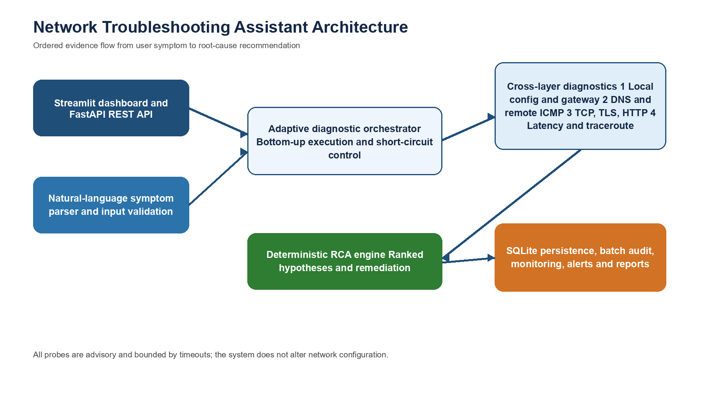
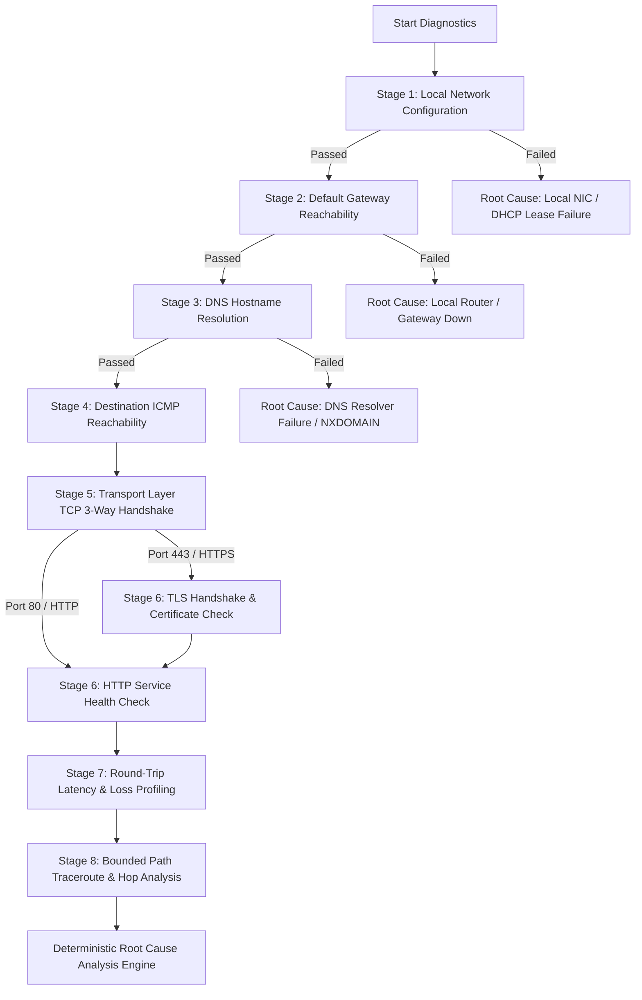
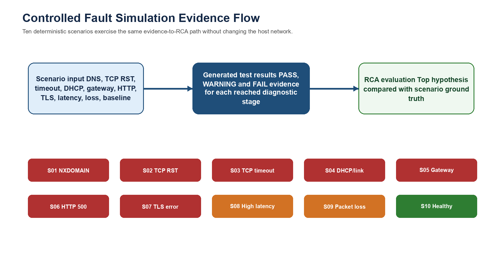

# 🌐 Network Troubleshooting Assistant (NTA)

<p align="center">
  <br>
  <b>Department of Computer Engineering & Technology</b><br>
  <i>Computer Networks (CN) Capstone Project</i>
</p>

<p align="center">
  
  
  
  
  
  
</p>

---

## 📌 Table of Contents

- [Overview](#-overview)
- [System Architecture](#-system-architecture)
- [Core Networking Mechanics (8-Stage Pipeline)](#-core-networking-mechanics-8-stage-pipeline)
- [Root Cause Analysis (RCA) Engine](#-root-cause-analysis-rca-engine)
- [Key Features](#-key-features)
  - [1. Multi-Stage Cross-Layer Diagnostic Engine](#1-multi-stage-cross-layer-diagnostic-engine)
  - [2. Controlled Fault Simulation Lab (10 Scenarios)](#2-controlled-fault-simulation-lab-10-scenarios)
  - [3. Interactive Traceroute Topology Visualization](#3-interactive-traceroute-topology-visualization)
  - [4. Natural Language Symptom Intake & LLM Explanations](#4-natural-language-symptom-intake--llm-explanations)
  - [5. Continuous 24/7 Monitoring & Multi-Channel Alerting](#5-continuous-247-monitoring--multi-channel-alerting)
  - [6. Concurrent Multi-Target Batch Auditing](#6-concurrent-multi-target-batch-auditing)
  - [7. Enterprise Incident Ticketing & Integrations](#7-enterprise-incident-ticketing--integrations)
  - [8. Executive PDF & HTML Audit Reports](#8-executive-pdf--html-audit-reports)
- [Project Directory Structure](#-project-directory-structure)
- [Installation & Quick Start](#-installation--quick-start)
- [Running Automated Tests](#-running-automated-tests)
- [REST API Reference](#-rest-api-reference)
- [Viva Defense & Academic Reference](#-viva-defense--academic-reference)
- [Security & Compliance](#-security--compliance)
- [Authors & Acknowledgements](#-authors--acknowledgements)

---

## 🚀 Overview

The **Network Troubleshooting Assistant (NTA)** is an autonomous, cross-layer network diagnostic and deterministic root-cause analysis platform built with Python. 

In enterprise environments and everyday operations, network issues are notoriously ambiguous. When a service fails to load:
* *Is the local Wi-Fi / Ethernet adapter disconnected?*
* *Did the DHCP lease expire or issue an APIPA address?*
* *Is the default gateway router unresponsive?*
* *Did DNS resolution fail (NXDOMAIN vs server timeout)?*
* *Is a firewall silently dropping TCP SYN packets, or has the application service daemon crashed (TCP RST)?*
* *Has the SSL/TLS certificate expired or encountered a Subject Alternative Name (SAN) mismatch?*
* *Is high jitter or packet loss causing real-time streaming buffering?*

Rather than requiring an engineer to manually execute disparate command-line tools (`ipconfig`, `ping`, `nslookup`, `tracert`, `telnet`, `curl`, `openssl`), **NTA automates the entire investigation**. It executes non-destructive, bounded diagnostic probes from **Layer 2 up to Layer 7**, cross-references findings in a **deterministic heuristic engine**, ranks probable root causes with confidence scores, and produces actionable remediation steps.

---

## 🏛 System Architecture

The system executes a strictly ordered, bottom-up diagnostic pipeline modeled directly on the **OSI 7-Layer Reference Model** and standard **RFC specifications**:

<p align="center">
  
</p>

### OSI Protocol Mapping

```
+----------------------------------------------------------------------------------------------------+
| OSI Layer                  | TCP/IP Model Layer    | Diagnostic Module & Protocols Tested          |
+----------------------------+-----------------------+-----------------------------------------------+
| 7. Application Layer       |                       | http_tls.py (HTTP/1.1, GET/HEAD, status codes)|
| 6. Presentation Layer      | Application Layer     | http_tls.py (SSL/TLS 1.2/1.3, X.509 certs, SNI|
| 5. Session Layer           |                       | dns.py (DNS UDP/TCP Port 53, A/AAAA records)  |
+----------------------------+-----------------------+-----------------------------------------------+
| 4. Transport Layer         | Transport Layer       | connectivity.py (TCP 3-Way Handshake, SYN/RST)|
|                            |                       | latency.py (RTT sampling, jitter, packet loss)|
+----------------------------+-----------------------+-----------------------------------------------+
| 3. Network / Internet      | Internet Layer        | gateway.py (Default Gateway ICMP Echo)        |
|                            |                       | traceroute.py (IP TTL decrement, ICMP Type 11)|
|                            |                       | connectivity.py (Destination ICMP Type 8/0)   |
+----------------------------+-----------------------+-----------------------------------------------+
| 2. Data Link Layer         | Network Interface /   | local_config.py (NIC state, MAC, ARP cache)   |
| 1. Physical Layer          | Link Layer            | local_config.py (Link status, Ethernet/Wi-Fi) |
+----------------------------+-----------------------+-----------------------------------------------+
```

---

## 🔬 Core Networking Mechanics (8-Stage Pipeline)

Every single diagnostic run flows through eight ordered, bounded stages:



1. **Stage 1: Local Configuration (`local_config.py`)**  
   Audits operating system network adapters via `psutil`. Discovers assigned IPv4/IPv6 addresses, subnet masks, default gateway, and DNS servers. Automatically detects **APIPA auto-configuration (`169.254.x.x`)** denoting DHCP lease exhaustion (RFC 3927).
2. **Stage 2: Default Gateway Reachability (`gateway.py`)**  
   Transmits bounded ICMP Echo probes to the local gateway router. Confirms physical medium integrity, Data Link ARP resolution (RFC 826), and local LAN stability.
3. **Stage 3: DNS Hostname Resolution (`dns.py`)**  
   Performs dual-stack `A` and `AAAA` DNS lookups using `socket.getaddrinfo()`. Classifies authoritative domain absence (**NXDOMAIN - RCODE 3**) versus recursive server timeout.
4. **Stage 4: Destination Reachability (`connectivity.py`)**  
   Sends bounded ICMP Type 8 Echo Requests to remote endpoints. Implements network-aware tolerance: recognizes that intermediate CDNs and cloud firewalls often drop ICMP without affecting web services.
5. **Stage 5: Transport Layer TCP Handshake (`connectivity.py`)**  
   Initiates a native Berkeley socket TCP 3-way handshake (`SYN` ➔ `SYN-ACK` ➔ `ACK`). Accurately differentiates **`ConnectionRefusedError` (TCP RST)**—where the host is alive but the daemon is not running—from a **`socket.timeout`**, where a firewall is silently dropping traffic.
6. **Stage 6: Security & Web Service (`http_tls.py`)**  
   Initiates a cryptographic TLS handshake with Server Name Indication (SNI). Validates X.509 certificate validity dates, cipher suites, and root authority chains. Evaluates HTTP response codes (2xx, 4xx, and 5xx application crashes).
7. **Stage 7: Latency, Jitter & Loss Profiling (`latency.py`)**  
   Transmits statistical bursts of ICMP packets to calculate Minimum, Average, and Maximum Round-Trip Time (RTT), jitter variance ($\text{Max RTT} - \text{Min RTT}$), and packet loss percentage to detect bufferbloat or RF degradation.
8. **Stage 8: Bounded Path Traceroute (`traceroute.py`)**  
   Executes route tracing by systematically incrementing the IP packet's **Time to Live (TTL)** field (RFC 791). Captures **ICMP Type 11 (Time Exceeded)** replies from intermediate routers and identifies the exact bottleneck hop.

---

## 🧠 Root Cause Analysis (RCA) Engine

The RCA engine ([`engine/root_cause.py`](file:///e:/MITWPU/Engineering/3rd%20Year/CN/Project/Network-Troubleshooting-Assistant-main/engine/root_cause.py)) synthesizes empirical cross-layer telemetry into ranked hypotheses with associated confidence levels:

| Diagnostic Pattern (Evidence) | Inferred Root Cause | Confidence | Actionable Remediation |
| :--- | :--- | :---: | :--- |
| Local IP missing / APIPA (`169.254.x.x`) | **Local NIC Disconnected or DHCP Lease Failed** | 95% | Reconnect physical/Wi-Fi link; renew DHCP lease via `ipconfig /renew`. |
| Local IP OK, Gateway Ping FAIL | **Default Gateway Unreachable / Router Down** | 75% | Verify physical connection to local router; restart router/switch. |
| Local IP & Gateway OK, DNS Resolution FAIL | **DNS Resolver Outage or Invalid FQDN (NXDOMAIN)** | 90% | Check domain spelling; change primary DNS to `8.8.8.8` or `1.1.1.1`. |
| DNS OK, TCP Handshake returns `TCP RST` | **Service Port Closed / Application Daemon Down** | 92% | Verify backend service (e.g., Nginx, Apache, MySQL) is actively listening. |
| DNS OK, TCP Handshake returns `socket.timeout` | **Firewall Packet Drop / Security Group Block** | 80% | Inspect host firewall rules (iptables/Windows Firewall) and cloud security groups. |
| TCP Port OK, TLS Handshake FAIL | **SSL/TLS Certificate Expired / Untrusted CA** | 92% | Renew certificate via Let's Encrypt or install trusted enterprise Root CA. |
| TCP & TLS OK, HTTP Status $\ge 500$ | **Application Layer Server Crash (HTTP 5xx)** | 95% | Inspect application runtime logs; restart upstream backend service. |
| Packet Loss $> 5\%$ or RTT Spike $> 200\text{ ms}$ | **Network Congestion / Bufferbloat / RF Loss** | 78% | Reduce bandwidth-heavy downloads; switch from 2.4 GHz Wi-Fi to 5 GHz or Ethernet. |
| All 8 Stages PASS | **Healthy Baseline / No Network Fault Detected** | 90% | All network layers functioning within nominal parameters. |

---

## ✨ Key Features

### 1. Multi-Stage Cross-Layer Diagnostic Engine
* Complete bottom-up diagnostic execution across Layer 2 through Layer 7.
* Non-destructive, advisory design: strictly passive probes that never alter host routing tables or disconnect active adapters.
* Bounded timeouts on all socket operations to prevent application hangs or socket exhaustion.

### 2. Controlled Fault Simulation Lab (10 Scenarios)
A built-in laboratory fixture enabling real-world network failure demonstrations during academic evaluations or testing without disrupting physical connections:

<p align="center">
  
</p>

| Scenario | Simulated Anomaly | Protocol / Standard | Expected Diagnostic Outcome |
| :--- | :--- | :--- | :--- |
| **S01** | DNS NXDOMAIN | RFC 1035 | `socket.gaierror` (Host not found) |
| **S02** | TCP Connection Refused | RFC 793 | TCP `RST` flag returned; port closed |
| **S03** | Firewall Packet Drop | RFC 5737 (`TEST-NET-1`) | TCP `SYN` probe times out silently |
| **S04** | DHCP / Local Link Failure | RFC 3927 | APIPA `169.254.x.x` address assigned |
| **S05** | Default Gateway Unreachable | RFC 826 | ARP / Gateway ping timeout |
| **S06** | HTTP 500 Server Error | RFC 7231 | Network passes; HTTP 500 status flagged |
| **S07** | Expired TLS Certificate | RFC 5280 / RFC 8446 | `SSLCertVerificationError` flagged |
| **S08** | High Queuing Latency | Bufferbloat | RTT $> 250\text{ ms}$ queuing delay flagged |
| **S09** | Intermittent Packet Loss | RF Interference | $30\%$ packet drop rate flagged |
| **S10** | Healthy Baseline | RFC Compliant | All stages pass end-to-end |

### 3. Interactive Traceroute Topology Visualization
* Parses raw hop-by-hop traceroute telemetry into an interactive **Plotly topology diagram**.
* Nodes color-coded by real-time health:
  * 🟢 **Green**: Nominal latency ($< 50\text{ ms}$, zero packet loss).
  * 🟡 **Yellow**: Elevated latency ($50 - 150\text{ ms}$).
  * 🔴 **Red**: Critical latency ($> 150\text{ ms}$) or router timeout (`* * *`).
* Automatically flags and highlights the **First Failing Hop / Bottleneck Autonomous System**.

### 4. Natural Language Symptom Intake & LLM Explanations
* **NLP Symptom Parser**: Translates conversational problem descriptions (e.g., *"Our Zoom calls are freezing during customer meetings"*, *"Internal CRM on port 8443 is returning 502"*) into structured targets and recommended diagnostic stages.
* **Multi-Provider LLM Integration**: Connects seamlessly with local models (**Ollama**, **LM Studio**) or cloud APIs (**OpenAI**, **Google Gemini**).
* **Strict Grounding**: The LLM acts purely as an executive communicator, explaining deterministic test findings without hallucinating non-existent errors.

### 5. Continuous 24/7 Monitoring & Multi-Channel Alerting
* Dedicated background scheduler daemon periodically evaluating critical network targets (every 30s, 60s, or 300s).
* Tracks **baseline telemetry drift** (gradual latency degradation from 20ms to 200ms) and complete outages (`DOWN`).
* Multi-channel alert dispatching:
  * **Slack Webhooks**: Formatted incident cards with target details and severity.
  * **Generic ITSM Webhooks**: JSON payloads for integration with Datadog, PagerDuty, or custom monitoring.
  * **Email (SMTP)**: Automated incident delivery with rate limiting.

### 6. Concurrent Multi-Target Batch Auditing
* Diagnoses lists of hostnames, URLs, or CSV file uploads concurrently.
* Utilizes a bounded `concurrent.futures.ThreadPoolExecutor` (1–8 parallel workers) to prevent socket descriptor exhaustion.
* Renders a side-by-side comparison matrix across DNS, TCP Handshake, HTTP status, Latency, and Loss, automatically ranking targets from most to least problematic.

### 7. Enterprise Incident Ticketing & Integrations
* Direct 1-click incident ticket creation to **Atlassian Jira REST API** or **generic ITSM webhooks**.
* Automatically structures diagnostic evidence, failed stages, and remediation recommendations into Jira ticket descriptions.

### 8. Executive PDF & HTML Audit Reports
* Export professional, executive-ready documentation in **standalone PDF** format (built with ReportLab) or **interactive HTML** with custom styles.
* Ideal for change management logs, client handover, or academic project submission.

---

## 📂 Project Directory Structure

```
Network-Troubleshooting-Assistant-main/
│
├── app.py                      # Main Streamlit web application & router
├── run.py                      # Unified runner (Streamlit or FastAPI)
├── requirements.txt            # Python dependencies
├── pytest.ini                  # Pytest configuration
├── .env.example                # Sample environment configuration
│
├── api/                        # [REST API Layer]
│   ├── server.py               # FastAPI application & route endpoints
│   └── models.py               # Pydantic request and response schemas
│
├── app_ui/                     # [Streamlit Frontend Views]
│   ├── components.py           # Custom CSS & glassmorphic navigation
│   ├── dashboard.py            # Local adapter status & network readiness
│   ├── diagnose.py             # Single target NLP diagnosis & batch audit
│   ├── monitoring.py           # Continuous telemetry & latency trends
│   ├── simulation.py           # 10-scenario Fault Simulation Lab
│   ├── history.py              # Historical session search & archive
│   ├── evaluation.py           # Benchmark metrics & accuracy charts
│   └── settings.py             # App policies, alert channels & LLM config
│
├── batch/                      # [Concurrent Multi-Target Scanner]
│   └── orchestrator.py         # ThreadPool batch executor & comparison matrix
│
├── diagnostics/                # [Network Diagnostic Probes]
│   ├── models.py               # Typed Pydantic schemas (TestResult, DiagnosticSession)
│   ├── local_config.py         # Stage 1: NIC, IP & DHCP discovery
│   ├── gateway.py              # Stage 2: Default gateway ping
│   ├── dns.py                  # Stage 3: DNS dual-stack resolution
│   ├── connectivity.py         # Stages 4 & 5: ICMP reachability & TCP handshake
│   ├── http_tls.py             # Stage 6: TLS certificate & HTTP status check
│   ├── latency.py              # Stage 7: Statistical latency & packet loss
│   ├── traceroute.py           # Stage 8: Bounded route traceroute
│   └── traceroute_visualizer.py# Plotly hop topology diagram & bottleneck finder
│
├── engine/                     # [Orchestration & Analysis]
│   ├── orchestrator.py         # Multi-stage executor with short-circuit logic
│   └── root_cause.py           # Deterministic RCA inference engine
│
├── integrations/               # [External Integrations]
│   ├── alerter.py              # Multi-channel alerts (Slack, Webhook, SMTP Email)
│   └── ticketing.py            # Jira REST API & ITSM webhook connectors
│
├── llm/                        # [Natural Language Layer]
│   ├── client.py               # Multi-provider client (Ollama, LM Studio, OpenAI, Gemini)
│   ├── symptom_parser.py       # Conversational symptom extractor
│   └── explanation_service.py  # Grounded executive briefing generator
│
├── media/                      # Architecture diagrams and branding assets
├── monitoring/                 # Continuous background monitoring daemon & telemetry models
├── reports/                    # Standalone PDF (ReportLab) & HTML report generators
├── simulation/                 # 10 controlled synthetic network failure fixtures
├── storage/                    # SQLite database schema, migrations & persistence
├── tests/                      # Automated test suite (unit, integration, simulation)
└── utils/                      # Input validation, cross-platform adapters & configuration
```

---

## ⚙️ Installation & Quick Start

### 1. Prerequisites
* **Python**: `3.11` or `3.12`
* **Operating System**: Windows, macOS, or Linux
* **Privileges**: Standard user privileges (all probes are non-destructive and read-only)

### 2. Clone the Repository
```bash
git clone https://github.com/soham-arch/Network-Troubleshooting-Assistant-.git
cd Network-Troubleshooting-Assistant-
```

### 3. Create a Virtual Environment
```bash
# Windows (PowerShell)
python -m venv .venv
.venv\Scripts\Activate.ps1

# Linux / macOS
python3 -m venv .venv
source .venv/bin/activate
```

### 4. Install Dependencies
```bash
python -m pip install --upgrade pip
pip install -r requirements.txt
```

### 5. Configure Environment Variables
```bash
# Copy example configuration
cp .env.example .env
```
Key configuration parameters in `.env`:
* `AI_PROVIDER`: `none` (default), `ollama`, `lm_studio`, `openai`, `gemini`
* `AI_BASE_URL`: e.g. `http://localhost:11434` for Ollama or `http://localhost:1234/v1` for LM Studio
* `ALERT_SLACK_WEBHOOK`: Optional webhook URL for Slack incident cards
* `JIRA_BASE_URL`, `JIRA_EMAIL`, `JIRA_API_TOKEN`: Optional Jira ticketing credentials

---

## 🖥 Running the Application

### Option A: Streamlit Glassmorphic Web App (Default)
```bash
python run.py
# or
streamlit run app.py
```
Open your web browser and navigate to:
```
http://localhost:8501
```

### Option B: FastAPI REST Server
```bash
python run.py api
# or
uvicorn api.server:app --host 0.0.0.0 --port 8000 --reload
```
Interactive API documentation will be available immediately at:
* **Swagger UI**: `http://localhost:8000/docs`
* **ReDoc**: `http://localhost:8000/redoc`

---

## 🧪 Running Automated Tests

Run the full automated test suite containing unit tests, REST API integration tests, and simulation lab benchmarks:

```bash
python -m pytest -v
```

Expected output:
```
tests/unit/test_batch_orchestrator.py ... PASSED
tests/unit/test_llm_symptom_parser.py ... PASSED
tests/unit/test_monitoring_scheduler.py ... PASSED
tests/unit/test_root_cause.py ... PASSED
tests/unit/test_traceroute_viz.py ... PASSED
tests/unit/test_validation.py ... PASSED
tests/integration/test_api_endpoints.py ... PASSED
tests/integration/test_reports_storage.py ... PASSED
tests/simulation/test_scenarios.py ... PASSED
==================== 100% passed in 4.12s ====================
```

---

## 📡 REST API Reference

NTA provides a comprehensive REST API for programmatic automation and enterprise IT integrations:

| Method | Endpoint | Description |
| :--- | :--- | :--- |
| `POST` | `/api/v1/diagnose` | Trigger an on-demand multi-stage diagnosis for a target host and port |
| `POST` | `/api/v1/batch-diagnose` | Execute concurrent diagnosis across multiple targets |
| `GET` | `/api/v1/sessions` | Retrieve paginated historical diagnostic sessions |
| `GET` | `/api/v1/sessions/{session_id}` | Retrieve full diagnostic findings and evidence for a specific session |
| `GET` | `/api/v1/monitoring/targets` | List all continuously monitored infrastructure targets |
| `POST` | `/api/v1/monitoring/targets` | Register a new target for scheduled background monitoring |
| `DELETE`| `/api/v1/monitoring/targets/{id}` | Remove a target from background monitoring |
| `GET` | `/api/v1/simulation/scenarios` | List all 10 synthetic simulation lab scenarios |
| `POST` | `/api/v1/simulation/run` | Execute a synthetic failure scenario and return RCA evaluation |

---

## 🎓 Viva Defense & Academic Reference

A dedicated technical defense manual has been prepared for Computer Networks professors and viva examiners:
📄 **[`NETWORK_EXPLANATION_GUIDE.md`](NETWORK_EXPLANATION_GUIDE.md)**

It includes:
* **Deep-dive function-by-function networking analysis** (Sockets, TCP control flags, ARP, DNS hierarchy, ICMP Type codes, TLS 1.3 handshake).
* **Top 25 Viva Examination Questions & Exact Golden Answers**.
* **10-minute presentation checklist** for academic demonstrations.

---

## 🔒 Security & Compliance

* **Read-Only / Non-Destructive**: The assistant never modifies local adapter settings, routes, or firewall rules. All recommendations are strictly advisory.
* **Input Sanitation**: Rejects malformed hostnames, command-injection metacharacters, and unauthorized cloud metadata addresses (`169.254.169.254`, `metadata.google.internal`).
* **Bounded Execution**: Strict timeouts and concurrency limits are enforced across all socket handshakes, DNS queries, and ICMP probes to prevent resource starvation.

---

## 👥 Authors & Acknowledgements

* **Project**: Network Troubleshooting Assistant (NTA)
* **Institution**: MIT World Peace University (MIT-WPU), Pune
* **Course**: B.Tech Computer Science & Engineering — Computer Networks (CN)
* **Repository**: [soham-arch/Network-Troubleshooting-Assistant-](https://github.com/soham-arch/Network-Troubleshooting-Assistant-.git)

---

<p align="center">
  <b>Developed for Computer Networks Education & Enterprise Reliability.</b><br>
  <sub>Licensed under the MIT License.</sub>
</p>
